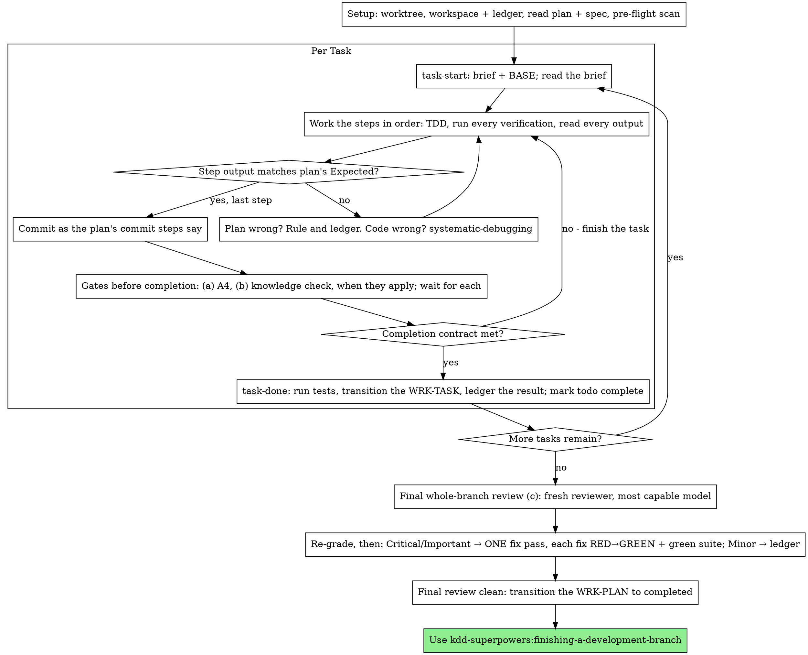

# Executing Plans

Execute the plan yourself, task by task, in this session: no implementer
subagent per task, no reviewer per task. One fresh-context review of the
whole branch at the end.

**Why inline:** Subagent-driven development pays for a fresh implementer
and a fresh reviewer on every task, each re-reading the codebase from zero.
Inline execution pays for one context (yours) plus one reviewer at the end.
What it gives up is a fresh context per task and a second pair of eyes per
task. This skill keeps what those two things bought, by other means: the
brief is the spec, the ledger is your memory, TDD is the per-task gate, and
the final reviewer is the second pair of eyes.

**Core principle:** The plan already did the thinking. Execute it exactly,
prove each step with a test you watched fail and then pass, and leave a
record that survives your own forgetting.

**Narration:** between tool calls, narrate at most one short line — the
ledger and the tool results carry the record.

**Continuous execution:** Do not pause to check in with your human partner
between tasks. They chose inline execution to spend less, not to answer
"should I continue?" after every task. Execute all tasks from the plan
without stopping.

**Rulings, not stalls.** Conflicts, ambiguities, plan defects — decide them.
The spec is the binding authority, the plan is its argument, and your
judgment settles what neither answers. Record every decision in the ledger
as `Ruling: <what you decided> — <why> — <what it costs if wrong>`, and keep
going. Deviating from the plan without a ledgered ruling is a decision made
in secret.

A ruling that touches knowledge — a step or the code you touch contradicts
an activated rule, a task needs a spec outside the frozen set, a brief
reports PIN DRIFT — is additionally tagged `Knowledge gap: <what is missing
or wrong>`. The activation stays frozen (P3); the gap is harvested at
finishing by consolidation. Never widen `activates` mid-plan. A knowledge
ruling about an activated rule is checked before its task completes (gate
(b) below).

Four things stop you, and only these: an irreversible or destructive
operation; a security-sensitive action; a side effect outside this worktree
that norms say you ask about first (a merge, a push to a shared branch, a
publish); and a plan so broken that every path forward is a guess. For
those, stop and ask.

## When to Use

- You have an active WRK-PLAN from kdd-superpowers:writing-plans and your
  human partner chose Native execution at the handoff.
- Tasks are mostly independent — the same precondition as
  kdd-superpowers:subagent-driven-development.

A fully specified plan makes inline execution transcription plus testing:
it runs well on a mid-tier session model, and the one place the most
capable model earns its cost is the final review, which this skill
dispatches separately. Tell your human partner so when they choose inline.

Prefer kdd-superpowers:subagent-driven-development when your human partner
wants a review gate on every task, or when the plan is long enough that
its later tasks would run on a compacted context. Inline execution over a
long plan still works — the ledger is what makes it recoverable — but the
last tasks get the least of you.

## The Process



## Setup

Ensure the work happens in an isolated workspace: use
kdd-superpowers:using-git-worktrees to create one or verify the existing one.
Never start implementation on a main/master branch without your human
partner's explicit consent.

Conversation memory does not survive compaction. An inline executor that
loses its place re-implements tasks whose commits already exist — the same
failure as a controller re-dispatching them, paid for in your own context.
Track progress in a ledger file, not only in todos. Harness todos are a
live view; the ledger is the record.

The workspace and ledger are shared with kdd-superpowers:subagent-driven-development
— same directory, same format — so a plan can change executors mid-flight
and the new one resumes from the same ledger.

- Each plan owns a workspace: at skill start, run
  `../subagent-driven-development/scripts/sdd-workspace PLAN_FILE` — it
  prints the plan's git-ignored directory
  (`<repo-root>/.kdd/sdd/<WRK-PLAN-ID>/`), home to every
  artifact for THIS plan: ledger, briefs, review packages. Another plan's
  directory is never yours to read or write.
- Check for this plan's ledger at `<workspace>/progress.md`
  (`.kdd/sdd/<WRK-PLAN-ID>/progress.md`). If its first line
  names your plan's ID, it is this plan's record, and
  a task is done when its frontmatter says `completed` — the signal both
  modes and `kdd-status` share — do not redo it; resume at the
  first task in Task Breakdown order whose file still says `active`. A
  `completed` task with no `Task <WRK-TASK-ID>: complete` line was
  interrupted between its transition and its line: re-run `task-done` for
  it, which appends the missing line with the task's original range. Their
  commits exist in git even when your context no longer remembers making
  them: after compaction, trust the task files, the ledger and `git log`
  over your own recollection. A ledger whose first line names a different
  plan ID is another plan's progress: leave it and start your own, fresh.
- The ledger's identity is its first line:
  `# SDD ledger — plan: <WRK-PLAN-ID> (<path>)`. `task-start` writes it
  when the ledger is absent.
- `git clean -fdx` will destroy the workspace (it's git-ignored scratch);
  if that happens, recover from `git log`.

Read the WRK-PLAN once — *Approach*, *Task Breakdown*, *Architecture
Impact* — and create a todo per WRK-TASK, in Task Breakdown order. Read
the WRK-SPEC it implements (its `parent`) too: the spec is the
authority the plan argues from, and conflicts inside the plan resolve
against it. A plan with no reachable spec gets a ledger note saying so —
rulings made without one are provisional.

**REQUIRED SUB-SKILL:** load kdd-superpowers:test-driven-development now,
before Task 1. It governs every step of every task below; a plan whose
steps already say "write the failing test first" does not exempt you
from reading it.

Before Task 1, scan the plan for conflicts between tasks. The
**Interfaces:** line of each WRK-TASK tells you where to look: for every task that consumes
what an earlier task produces, one ledger row — the two tasks, what one
produces against what the other consumes, and what you found. Tasks that
share nothing get no row; a plan whose tasks share nothing gets the single
line `Pre-flight: no shared interfaces`. Rule on each conflict a row
surfaces with the spec as the binding authority, record the ruling beside
its row, and start Task 1. Each task's own text is checked when you read
its brief, not here.

## The Task Loop

Everything you print, and every tool result, stays resident in your
context for the rest of the session. Redirect long test output to a file
in the workspace and read its tail; read a brief, not the whole plan.

### 1. Take the task

- Run this skill's `bash scripts/task-start PLAN_FILE TASK_FILE` (TASK_FILE
  is the WRK-TASK file from Task Breakdown). It writes the task's brief
  with `../subagent-driven-development/scripts/task-brief` and prints the
  brief path and BASE (the commit the task's range is cut from) in one call.
  Read the brief for every task, including ones you remember from setup:
  what you remember is a summary, the brief has the exact values,
  signatures, and test cases. Its sections are the task, the plan's
  Architecture Impact, every activated spec in full and the FRAGs the task
  cites; sections 2–4 are requirements. If the brief shows PIN DRIFT,
  ledger it as `Knowledge gap:` and implement what the task says.
- Mark the task's todo in_progress.

Every tool call is a turn that re-reads your whole context. Bookkeeping
rides along with work — a ledger append in the same call as the commit,
never in a call of its own.

### 2. Work the steps

The plan's steps are already in RED-GREEN order; follow them in that
order under kdd-superpowers:test-driven-development, loaded at setup. A test
step's code is written first and run first. Watching it fail is a step,
not a formality — a test that passes before the implementation exists is
a finding about the test.

Every step that runs a command has an `Expected:` line. Run the command,
read its output, and compare. Three outcomes:

- **Matches.** Next step.
- **The code is wrong.** Use kdd-superpowers:systematic-debugging. Find the
  cause; never patch the symptom to make the step's output match.
- **The plan is wrong** — a step contradicts the spec, an interface from an
  earlier task doesn't match what this task consumes, a command that
  cannot work. Rule on the smallest change that satisfies the spec, ledger
  it as `Task <WRK-TASK-ID>: Ruling: <finding> — <what you decided and why>`, and
  continue. The ruling is carried, not remembered: later tasks that touch
  the same interface read it from the ledger. When the step, or the code
  you touch, contradicts an activated rule, the ruling is also tagged
  `Knowledge gap: <rule ID> — …`, and gate (b) checks the task.

Commit as the plan's commit steps say; every commit subject starts with
the WRK-TASK ID. A task that spans several commits
is fine; BASE is what the review range is cut from, never `HEAD~1`.

### 3. Gates before completion

The gates SDD gives a task, other than its per-task reviewer, run here
too. Gates (a) and (b) run before `task-done`: `task-done` transitions the
WRK-TASK and writes its completion line, and a gate after it checks a task
already recorded as complete. Each is a dispatch: give it an explicit
model, wait for its result before `task-done`, and never end your turn
while one is pending.

- **(a) Gate A4 — break the tests.** When the task's `activates` names a
  `CALC-*` spec or a spec with numeric or business rules, or the task is
  security-sensitive — judged on the task's frontmatter and its
  Architecture Impact rows — dispatch
  [test-adversary-prompt.md](../subagent-driven-development/test-adversary-prompt.md)
  on a mid-tier model with the brief, the task's test files and its diff
  (`../subagent-driven-development/scripts/review-package PLAN_FILE BASE HEAD`).
  A BROKEN row means the tests admit an implementation that violates the
  task or a rule: fix it by TDD — a test that fails, then passes — and
  commit. Then dispatch it once more on the fixed tests. A row still
  BROKEN after that is parked with a ruling. Ledger every row as SDD does:
  `Attack: … — Ruling: …`.
- **(b) Knowledge check.** When this task ledgered a `Ruling:` tagged
  `Knowledge gap:` about an activated rule, dispatch
  [knowledge-check-prompt.md](knowledge-check-prompt.md) on a mid-tier
  model with the brief, that ruling line and the review package of the
  task's range (`../subagent-driven-development/scripts/review-package
  PLAN_FILE BASE HEAD`) — once per such ruling. A violation it reports is
  blocking: fix it in this task, by TDD, before `task-done`. No knowledge
  ruling goes unchecked into the next task.
- **(c) A3 and A5** run once, for the whole branch, in the final review
  (*Final Review* below).

### 4. The completion contract

Before a task's ledger line, all of the following are true, with evidence
in this session — not inferred from the diff looking right:

- Every test the brief names exists and ran in this task, and you read
  the output.
- The final test run for the task passed — `task-done` is that run, and
  it writes the command and result into the ledger line.
- Every `Expected:` line in the brief was compared against real output.
- Every deviation from the brief has a `Ruling:` line in the ledger.
- Every gate of step 3 that applies ran and returned, and each BROKEN row
  or violation it found is fixed or ledgered.

**REQUIRED SUB-SKILL:** kdd-superpowers:verification-before-completion governs
the claim. If any item is missing, the task is not complete: finish it.

### 5. Complete the task

Run this skill's `bash scripts/task-done PLAN_FILE TASK_FILE BASE -- <test command>`
with the test command the brief names for the whole task. It runs the
tests, keeps the full output in the workspace, prints the tail, and — only
if they pass — transitions the WRK-TASK to `status: completed` with
`../kdd-conventions/scripts/transition` (commit `chore(<WRK-TASK-ID>):
complete`) and appends the completion line to the ledger:

`Task <WRK-TASK-ID>: complete (commits <base7>..<head7>, tests: <command> → <result>)`

A failing run records nothing; the task is not complete. When it records,
mark the todo complete and take the next task.

## Final Review

Run `../subagent-driven-development/scripts/review-package PLAN_FILE MERGE_BASE HEAD`
(MERGE_BASE = the commit the branch started from, e.g.
`git merge-base main HEAD`) and review from the file it prints. Run
`../requesting-code-review/scripts/review-brief PLAN_FILE` for the review
brief.

Dispatch the reviewer on the most capable
available model — the whole-branch review is a judgment task — using
kdd-superpowers:requesting-code-review's
[code-reviewer.md](../requesting-code-review/code-reviewer.md), with the
package path, `{MODE}: kdd-work`, `{KNOWLEDGE_BRIEF}: <review-brief path>`
and `{BEFORE_MERGE}: yes`, the plan and spec paths, the plan's Review Focus section
verbatim if it has one (the input classes and failure modes the plan's
tests do not exercise — the reviewer checks each deliberately), and a
pointer to the ledger's `Ruling:` lines so it can weigh the calls you
made. Specify the model
explicitly; an omitted model inherits the session's, which may not be the
most capable. This is the one fresh context the whole run buys. Do not
skip it, and do not replace it with your own read of the diff.

Those three placeholders are gate (c): A3 for every activated rule the
branch touches, and A5 for every acceptance criterion of the WRK-SPEC.
Their BROKEN rows are findings like any other. Wait for the review: no
fix, transition or final message while it is pending.

Sort the findings before you act on any of them. The reviewer's severity
labels are advice; the gate is yours. Re-grade first, by effect: the
spec is a vision document, and a finding's grade is what a reasonable
person using this software gets if it ships, not whether the spec names
the input that triggers it — a reviewer who set a finding at Minor
because the spec was silent has graded the spec, not the effect. Then:

- **Critical and Important** enter the fix pass.
- **Minor** goes to the ledger as `Final: minor (deferred): <one-liner>`
  and to your final message under "Deferred minors". Minors never enter
  the fix pass, and never become rulings — a ruling is a decision about a
  conflict, not a note that you declined a polish suggestion.

Fix the Critical and Important findings yourself — you are the
implementer here — in ONE pass. Each fix is verified by TDD, not by a
second reviewer: write the test that reproduces the finding, watch it
fail, make it pass, then run the whole suite. Record each in the ledger as
`Final: fixed <finding> — <test name> RED→GREEN, suite <N>/<N>`. A fix
without a test that failed first is not verified; a suite that is not
green after the pass means the pass is not over. Do not dispatch a
re-review: it would re-read a diff whose covering tests already answer
"addressed" and whose suite run already answers "broke nothing".

A finding you decide not to fix is a ruling — `Final: Ruling: <finding> —
<why the code stands> — <cost if wrong>` — and reaches your human partner
in the rulings list. There is no second fix pass.

## Finish

Before you hand over, collect every ledger line containing
`Ruling:` into your final message under "Rulings I made", in the order you
made them, each with what it costs if wrong, and every `minor (deferred)`
line under "Deferred minors". Both lists are exhaustive. Your final
message is the only place the decisions you took on your human partner's
behalf — and the findings you chose not to act on — reach them.

When the final review is clean and its fixes are committed, transition the
WRK-PLAN to completed: `../kdd-conventions/scripts/transition --specs specs
<plan file> completed` (commit `chore(<WRK-PLAN-ID>): complete`), as SDD
does. The WRK-SPEC stays `active` — finishing closes it. Leave this plan's
workspace in place: kdd-superpowers:finishing-a-development-branch harvests the ledger and deletes
the workspace. Sibling directories belong to other plans; leave them alone.

Use kdd-superpowers:finishing-a-development-branch.

## Common Rationalizations

| Excuse | Reality |
|--------|---------|
| "I remember what Task N says" | You remember a summary. The brief has the exact values. Read it. |
| "The plan's code is right, skip watching the test fail" | A test you never saw fail proves nothing. It is one step. Run it. |
| "I'll run the full suite at the end instead of per step" | Per-step runs are how you learn which step broke it. The end-of-task run is the contract, not a substitute. |
| "The plan is wrong here, I'll just do the right thing" | Do the right thing and ledger the ruling. Unledgered deviation is a decision made in secret. |
| "I'll write the ledger lines after a few tasks" | Compaction does not wait for a convenient moment. One line per task, in the same message as the commit. |
| "Let me check in before the next task" | They chose inline to spend less. Progress prompts spend their time instead. Only the four stops stop you. |
| "I read my own diff carefully; the final reviewer is redundant" | Same author, same blind spots. The reviewer is the only fresh context this run buys. |
| "Tests should pass, the change was trivial" | "Should" is not evidence. The contract requires the command and its output. |
| "Subagents are slow and expensive, I'll skip the final review too" | Inline already removed the per-task reviewers. One review of the whole branch is the floor, not the ceiling. |
| "The reviewer said Minor, so it's Minor" | The label graded the spec's silence. Grade what the person gets. Re-grade, then gate. |
| "The fix is obvious, no need for a failing test first" | The failing test is the only proof the finding was real and is now gone. Without it you have a diff and a hope. |
| "I'll fix the minors too while I'm in there" | Every minor you fix is a test, a fix, and a suite run your partner did not ask for. Ledger them; your partner decides. |
| "I'll run A4 after `task-done`, the task is basically finished" | `task-done` records the task complete. A gate after it checks work already on record as done. Gates first, and wait for them. |
| "My knowledge ruling is obviously right; the check would only agree" | A change that violates an activated rule is a blocking finding. The check is what makes your ruling safe for the next task to build on. |

## Example Workflow

```
You: I'm using the executing-plans skill to implement this plan inline.

[Setup: worktree verified]
[Read plan once: specs/work/WRK-PLAN-AUTH-HOOKS-001-hook-installation.md; spec read]
[Resolve workspace: sdd-workspace specs/work/WRK-PLAN-AUTH-HOOKS-001-hook-installation.md — no ledger inside, fresh start]
[Pre-flight scan: 2 shared-interface rows, 4 self-consistency rows, clean; written to ledger]
[Create todos for all tasks]

Task 1: Hook installation script

[task-start plan WRK-TASK-AUTH-HOOKS-001-001 → brief read; BASE a1b2c3d]
[Step 1: write failing test — written]
[Step 2: run it — FAIL: install_hook not defined. Matches Expected.]
[Step 3: implement — written]
[Step 4: run it — PASS 1/1. Matches Expected.]
[Step 5: commit — d4e5f6a]
[Gates: activates no numeric rule, not security-sensitive → no A4; no knowledge ruling → no check]
[Contract: tests ran, output read, no deviations]
[task-done plan WRK-TASK-AUTH-HOOKS-001-001 a1b2c3d -- npm test -- hooks → chore(WRK-TASK-AUTH-HOOKS-001-001): complete; ledger: Task WRK-TASK-AUTH-HOOKS-001-001: complete (commits a1b2c3d..d4e5f6a, tests: npm test -- hooks → 1/1 pass)]

Task 2: Recovery modes

[task-start plan WRK-TASK-AUTH-HOOKS-001-002 → brief read; BASE 9f8e7d6]
[Step 2: run failing test — FAIL, but on an import error: Task 1 exported
 installHook, brief consumes install_hook]
[Ruling: brief's consumer name is a typo against Task 1's Produces line;
 use installHook — Ledger: Task WRK-TASK-AUTH-HOOKS-001-002: Ruling: install_hook → installHook — matches Task 1 Produces — cost if wrong: one rename]
[Steps 2-5 as planned; commit b7c8d9e]
[task-done plan WRK-TASK-AUTH-HOOKS-001-002 9f8e7d6 -- npm test -- recovery → ledger: Task WRK-TASK-AUTH-HOOKS-001-002: complete (commits 9f8e7d6..b7c8d9e, tests: npm test -- recovery → 8/8 pass)]

...

[After all tasks: review-package plan MERGE_BASE HEAD; review-brief plan; dispatch code-reviewer, most capable model, {MODE}: kdd-work, {BEFORE_MERGE}: yes]
Reviewer: One Important finding — progress reporting interval hardcoded. Two Minor.
[Re-grade: Important stands; minors → ledger as deferred]
[Fix pass: test_progress_interval_configurable RED → extract PROGRESS_INTERVAL → GREEN; suite 12/12; commit]
[Ledger: Final: fixed hardcoded interval — test_progress_interval_configurable RED→GREEN, suite 12/12]
[transition --specs specs plan completed → chore(WRK-PLAN-AUTH-HOOKS-001): complete]

Rulings I made:
- Task 2: install_hook → installHook (brief typo; cost if wrong: one rename)

Deferred minors:
- README lacks a usage example
- recovery.js could split verify/repair into two files

[Workspace left in place — finishing harvests the ledger and deletes it]

Using kdd-superpowers:finishing-a-development-branch.
```
